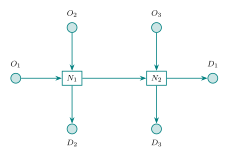

# Two-intersection tutorial

The tutorial is intentionally smaller than the manuscript's 4x4 grid, but it exercises the same model components.



The network contains:

- three origin links;
- two signalized intersections (`N1`, `N2`);
- one internal corridor link;
- three destination links;
- seven directed links;
- eight signalized movements.

Unlike the older draft tutorial, each incoming approach has two admissible outgoing movements. Therefore OD destination genuinely affects routing and movement demand.

Run a short version:

```bash
python examples/two_intersection_tutorial.py --quick --skip-html
```

Run the full tutorial with interactive replay:

```bash
python examples/two_intersection_tutorial.py
```

The output directory contains network/cell/movement CSV diagnostics, conservation checks, plots, and an HTML replay. The most useful fields to inspect first are:

- cell occupancy by commodity/class;
- routing probabilities;
- movement flow;
- physical accumulation;
- virtual-origin queues;
- cumulative entry/exit;
- conservation residual.
